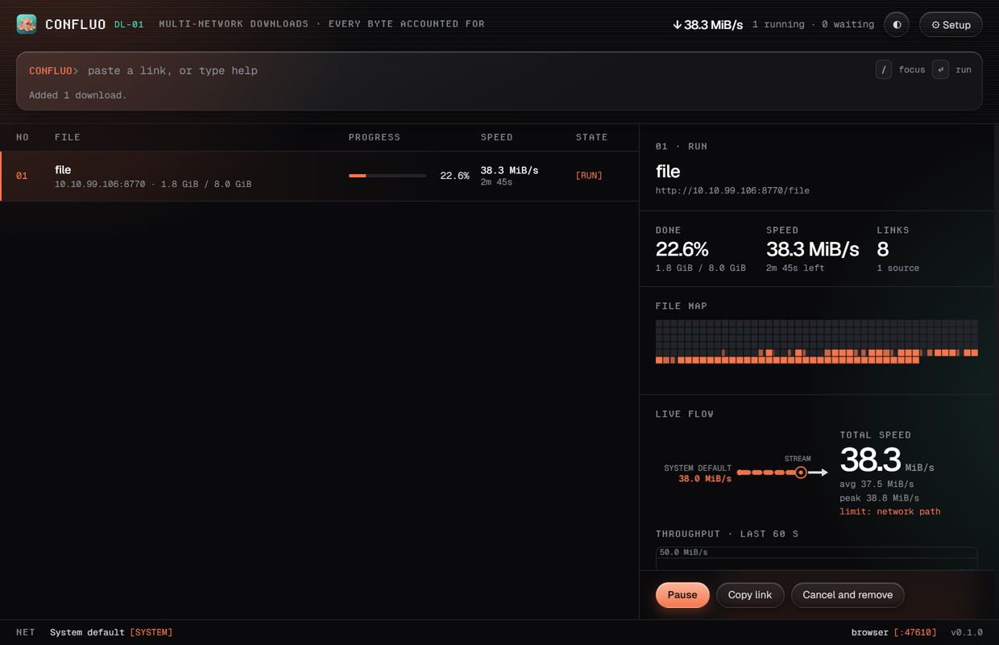
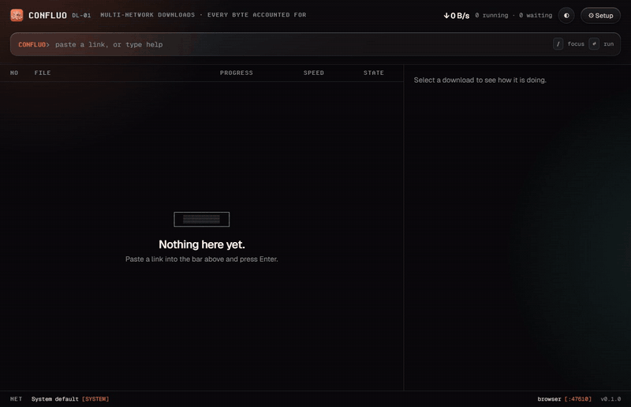
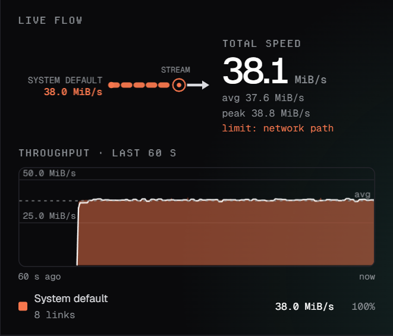
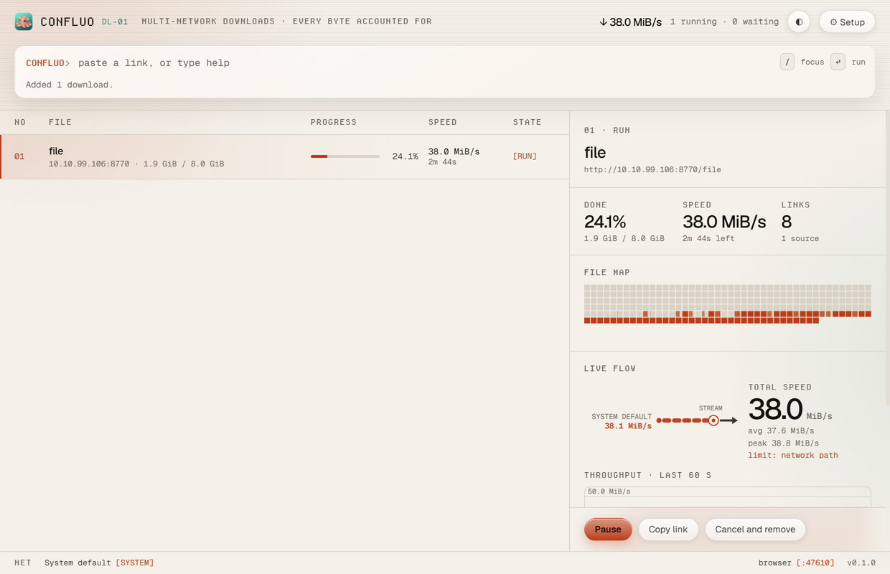
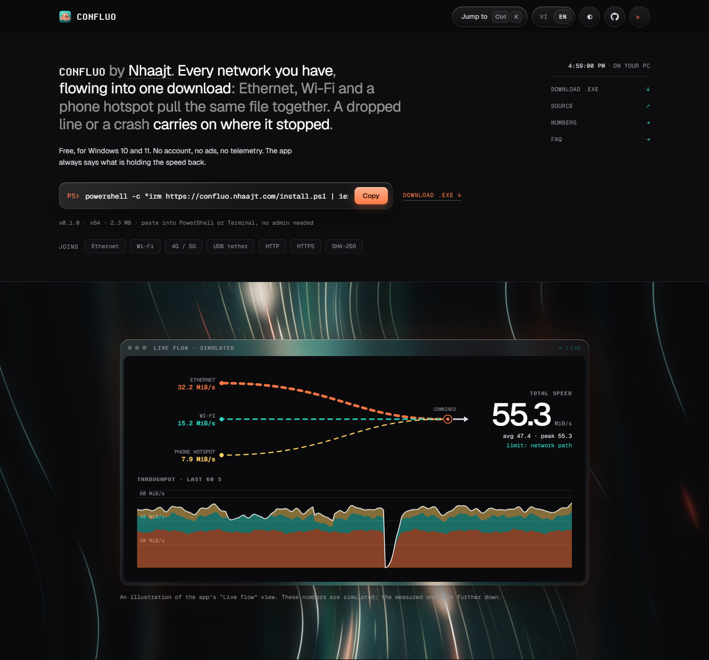

<p align="center">
  
</p>

<h1 align="center">Confluo</h1>

<p align="center">
  <b>Every network you have, flowing into one download.</b><br>
  A download manager for Windows that splits one file over several connections and several
  networks at once, carries on after a crash, and tells you what is holding the speed back.
</p>

<p align="center">
  <a href="https://confluo.nhaajt.com"><b>Website</b></a> ·
  <a href="https://github.com/nhaajtt/confluo/releases/latest"><b>Download</b></a> ·
  <a href="#install">Install</a> ·
  <a href="#benchmarks">Benchmarks</a> ·
  <a href="#how-it-works-and-why">How it works</a>
</p>

<p align="center">
  <a href="https://github.com/nhaajtt/confluo/actions/workflows/ci.yml"></a>
  <a href="https://github.com/nhaajtt/confluo/releases/latest"></a>
  
  <a href="LICENSE"></a>
</p>



## Demo



The same recording as a video: [`docs/demo.mp4`](docs/demo.mp4). It was captured from the real app
downloading an 8 GiB file from the test server in this repository, which was set to serve
38 MiB/s. The machine has one internet line, so one network is shown.

## What it does

- **Uses every network at once.** Each connection is pinned to its own adapter, so Ethernet,
  Wi-Fi and a phone hotspot carry the same file together. The faster one takes the larger share,
  and if one drops the others take over its part.
- **Adds connections only when they help.** It starts with 8, measures, and goes to 16 or 32 only
  if the speed follows. A server that refuses is asked again a second later, not hammered.
- **Carries on after a crash.** Twice a second it records which bytes are safely on disk. Killed
  11 times during a 1 GiB download in testing, the file still came out byte-exact.
- **Says what is slow.** The network path, a server capping each connection, a server refusing
  connections, the disk, or your own limit: the app names the one cause.
- **Takes downloads from the browser.** The companion extension hands downloads from Chrome, Edge
  or Firefox to the app over `127.0.0.1` only, with a pairing code that never leaves the PC.
- **Small.** A 2.4 MB installer, ready about half a second after launch, no account, no ads,
  no telemetry.

## Screenshots

| Live flow | Light theme |
|---|---|
|  |  |

The download page, [confluo.nhaajt.com](https://confluo.nhaajt.com):



## Install

One line in PowerShell or Windows Terminal, no admin rights needed:

```powershell
powershell -c "irm https://confluo.nhaajt.com/install.ps1 | iex"
```

It downloads the installer, checks its SHA-256 and installs for your user only. Run it again to
update. Or download `Confluo_0.1.0_x64-setup.exe` from the
[latest release](https://github.com/nhaajtt/confluo/releases/latest); it is not code-signed yet,
so Windows SmartScreen asks before running it (More info, then Run anyway).

Confluo is written in Rust with a Tauri shell. Windows is the tested platform; the engine also
builds and passes its tests on Linux and macOS.

## Build and run

Needs Rust (stable, 1.88+), Node 22 and pnpm. On Windows the WebView2 runtime (part of Windows 11).

```sh
cargo test --workspace                 # engine, bridge and test-server tests
cargo build --release -p confluo-cli      # target/release/confluo(.exe), the engine without a window

cd app
pnpm install
pnpm tauri dev                         # run the desktop app
pnpm tauri build                       # installer in target/release/bundle/nsis/
pnpm typecheck && pnpm lint
```

Command line:

```sh
confluo get https://example.com/big.iso -o D:\Downloads
confluo get <link> <mirror-link> --checksum sha256:<hex>
confluo get <link> -i "Ethernet" -i "Wi-Fi"     # use exactly these interfaces
confluo interfaces
```

Ctrl-C pauses; running the same command again continues.

Browser extension: load the `extension/` folder as an unpacked extension, then paste the pairing
code from Confluo (Setup, Browser) into the extension.

Download page: `node site/prepare.mjs [https://your.domain]` assembles `site/dist/` (the page, the
installer, its SHA-256 and `install.ps1` with both filled in), ready to upload to any static host.

## Layout

| Path | What it is |
|---|---|
| `crates/confluo-net` | Interface discovery, sockets pinned to an interface, change notifications |
| `crates/confluo-engine` | Probe, scheduler, connection tuner, disk writer, journal, download list |
| `crates/confluo-bridge` | Loopback service the browser extension talks to |
| `crates/confluo-cli` | `confluo` command |
| `crates/confluo-testsrv` | File server that misbehaves on purpose (caps, drops, stalls, no ranges, expiring links) |
| `app/` | Desktop app (Tauri 2, SolidJS) |
| `extension/` | Browser extension (Manifest V3) |
| `extension/test/` | Drives the unpacked extension in real Chromium and Firefox against the real app |
| `site/` | Download page (English and Vietnamese) and the PowerShell install script |
| `bench/` | Benchmark harness, kill-and-outage soak, results |

## How it works, and why

**Sockets are pinned to the interface, not to an address.** Windows uses `IP_UNICAST_IF`, Linux
`SO_BINDTODEVICE`, macOS `IP_BOUND_IF`. Binding only the source address leaves the routing table in charge, so with two default
routes everything can leave through one adapter. Evidence here: a Confluo connection pinned to an
adapter with no route to the server fails with "network unreachable" instead of quietly going out
through another adapter.

**Few long requests.** Every new range request makes the server restart TCP slow start, and some
servers count requests (one public mirror answered HTTP 429 to an earlier design that used many
medium-sized ranges). So the probe itself asks for the whole file and its response becomes the
first data stream; other connections are opened while the probe is in flight; each connection then
takes a share of the remaining bytes in proportion to its measured speed. A connection that
finishes early takes over the tail of the slowest one.

**The number of connections is measured, not assumed.** The tuner starts with 8, waits for the
speed to level off, and adds connections only while that buys at least 10% more speed; a jump of
60% or more is accepted a quarter of a second after it shows, without waiting out the full second.
It gives connections back when they bought nothing, holds still under a speed limit you set, and
lowers a ceiling when the disk falls behind or the server refuses. A refusal says little about
where the limit is (several connections are usually refused in the same instant), so the ceiling is
tested with one extra connection a second later, and each test that is refused again doubles the
wait up to a minute. A server that counts requests (HTTP 429) is tested every 15 s at most.

**A stuck connection cannot hold the end of the file.** A connection reports its speed at least
twice a second. One that reports nothing for two seconds, or would need more than five seconds for
a small remainder, has the rest of its range handed to a faster connection.

**One writer, one file handle, bounded queue.** A slow disk slows the sockets instead of filling
memory. Space is reserved without zero-filling (sparse on NTFS, `fallocate` on Linux).

**The journal never claims bytes that are not on disk.** Twice a second the file is flushed
and then the list of completed byte ranges is replaced atomically. After a crash, exactly those
ranges are kept.

**Honest about limits.** Each download shows what holds it back: the network path, a per-connection
cap, a server refusing connections, a server that cannot resume, the disk, or your own limit. If two
interfaces share one router the app says that adding them up cannot help.

**Decisions on technology.** Rust for the engine because interface pinning needs raw socket options
and because the measured CPU and memory cost of an Electron main-process engine is high (see below).
Tauri for the shell because the system WebView makes the installer 2.3 MiB. HTTP/2 is not used on
purpose: it multiplexes everything over one TCP connection, which defeats both per-interface
routing and parallel flows.

## Safety

- The window can only call a fixed set of commands. It names downloads by id; it never passes a
  file path to open or delete.
- Server-supplied file names are reduced to a plain name; nothing can be written outside the
  download folder (tested with `..\..\` names).
- Cookies and credentials are sealed with Windows DPAPI before being saved; on other systems they
  are not saved at all. They go only to the origin of the link you gave: not to another host or
  port after a redirect, and never from HTTPS down to HTTP.
- A redirect from a public site to this computer or to a private or link-local address is refused.
  (Only addresses written as such are recognised; a public name that resolves to a private address
  is not.)
- The browser bridge listens on `127.0.0.1` only and refuses requests with a web `Origin` or a wrong
  `Host` (DNS rebinding). The extension never sends the pairing code: it checks that the listener
  can sign a random number with the code (so another program on that port gets nothing), and signs
  each offer, with a timestamp, using HMAC-SHA256. Without a secret, any local program could do the same.
- File names from servers lose path separators, reserved Windows names and invisible characters
  that reorder text (so `exe.pdf` tricks do not survive).
- The saved list is written whole and flushed before it replaces the old one. On load, limits in it
  are clamped, an unreadable list is set aside as `downloads.json.unreadable`, and a path in it is
  only deleted or opened inside the download's own folder.
- With a VPN active, automatic mode leaves routing to the system so traffic does not go around the
  VPN. Choosing an adapter by hand overrides that, and the app says so.

## Benchmarks

Machine: Windows 11, i9-14900KS, 32 GB. Both apps download from `confluo-testsrv` on this machine's
LAN address, 7 runs each. The other downloader is an open-source Electron app, built from source with its own
build script and driven through its real window with Playwright. Reproduce with:

```sh
bench/.venv/Scripts/python bench/bench.py --ip <a LAN address of this machine> --runs 7
bench/.venv/Scripts/python bench/crash.py --ip <same> --runs 3
bench/.venv/Scripts/python bench/soak.py  --ip <same> --events 12
```

Raw output is in `bench/results/` (`20261111-043403` is the run quoted here). Times are seconds,
median with mean ± 95% confidence interval of the mean in brackets.

| Scenario | Confluo app | Other downloader | Result |
|---|---|---|---|
| No limit, 1 GiB | 1.70 (1.67 ± 0.07) | 6.36 (6.31 ± 0.26) | Confluo 3.7x faster |
| Server caps each connection at 1 MiB/s, 200 MiB | 7.32 (7.32 ± 0.02) | 7.48 (7.50 ± 0.04) | Confluo 2% faster |
| Server allows 4 connections, 200 MiB | 25.54 (25.50 ± 0.21) | 26.11 (26.10 ± 0.03) | Confluo 2% faster |
| Server without Range support, 200 MiB | 5.18 (5.19 ± 0.02) | 5.29 (5.30 ± 0.03) | Confluo 2% faster |
| 150 ms before each response, 4 MiB/s per connection, 200 MiB | 3.72 (3.63 ± 0.13) | 3.62 (3.63 ± 0.03) | no difference shown |
| One 20 MiB/s bottleneck, 200 MiB | 10.30 (10.30 ± 0.01) | 10.16 (10.14 ± 0.03) | **other 1.4% faster** |

The three server-limited rows were losses of 11%, 11% and 21% in the previous round (8.32, 29.3
and 4.48 s). What changed: the per-network speed meter no longer lags a tick behind, a clear gain
is accepted early, every lease worth splitting gets a new connection at once, and a refused
connection ceiling is tested again after one second instead of fifteen.

What is still not a win:

- **One shared bottleneck: the other downloader is 1.4% (0.14 s) faster**, consistently. Confluo spends about that
  long at the start finding out that 16 connections do no more than 8.
- **Slow first byte: no difference can be claimed.** The means are equal; Confluo's runs fall into two
  groups a quarter of a second apart (3.47 and 3.72 s) depending on which tick the tuner decides
  on, so its median is 3% worse and its best run 4% better.
- **One of the 7 Confluo-app runs with the 4-connection server did not finish within the harness's
  15 minutes** and is not in the numbers above (the other six and all seven CLI runs are). It did
  not happen again in 16 further runs. A cause was found that fits and was fixed: on Windows the
  saved list could not be replaced while another program had it open (the harness reads it every
  20 ms), and that failure was ignored, so a download could finish without "completed" ever being
  written. Replacing a file now retries for up to two seconds (`disk::replace_file`, with a test
  that holds the file open). Because the failure could not be reproduced, it cannot be shown that
  this was the cause.
- With `--rate-conn` the server sees up to 38 connections open for a moment although Confluo never
  runs more than 32: a connection whose tail was handed to another one is closed mid-response and
  the server notices a little later.

| Cost | Confluo engine (CLI) | Confluo app | Other downloader |
|---|---|---|---|
| CPU time per download (range over scenarios) | 0.1 - 1.7 s | 2.0 - 3.5 s | 12.8 - 60.1 s |
| Peak memory, whole process tree | 11 - 48 MiB | 358 - 395 MiB | 596 - 700 MiB |
| Requests for a 200 MiB file | 1 - 83 | same | about 200 |
| Installer | | 2.3 MiB | 258 MiB |
| Launch to ready (installed copy, 3 starts) | | 0.5 - 0.8 s | not measured the same way |

| Hard kill at 50% of a 200 MiB download, then relaunch | Confluo | Other downloader |
|---|---|---|
| File intact afterwards (3 of 3 runs) | yes | yes |
| Bytes fetched again | 6 - 16 MiB | 112 - 113 MiB |

**Soak (`bench/soak.py`).** A 1 GiB download at 40 MiB/s, interrupted 12 times at random moments
(11 hard kills of the downloader, 1 kill of the whole server with a restart seconds later): the
file had the SHA-256 of an undisturbed download and nothing was left behind. 223 MiB (22%) was
fetched twice, about 19 MiB per kill: what arrived since the last journal write half a second
earlier, plus what the server had already pushed into sockets.

**Desktop app under load.** Five minutes at 20 MiB/s with the flow panel animating: memory of the
whole process tree stayed between 407 and 465 MiB with no upward trend, the page's JavaScript heap
was 5 MiB with 124 DOM nodes at the end. CPU: the engine process about 7% of one core, the WebView
renderer and GPU processes together about 21% of one core (the animated flow drawing at 20 frames a
second and four data updates a second). Frame times were not measured.

Not measured, and therefore not claimed:

- **Real gain from two internet connections.** This machine has one uplink. With emulated links
  (`confluo get --emulate-links 4m,2m`), Confluo reached 83-95% of the sum of the links on a 60 MiB file.
  That shows the scheduler; it does not show two real networks. Nothing can make two interfaces
  behind the same router faster than one.
- Runs longer than five minutes, and files larger than 8 GiB.
- Public internet speed: one public mirror varied from 3.4 s to 11.9 s for the same file with
  plain `curl`, so it could not separate the tools. Files downloaded from it matched `curl` byte
  for byte.

## Tests

`cargo test --workspace`: 74 tests on Windows (73 elsewhere), plus one slow test run with
`--release -- --ignored` that downloads a 4.2 GiB file and compares every byte. The engine tests
run real downloads against the misbehaving server and compare every completed file byte for byte.
Covered: parallel ranges, servers without ranges or without a length, dropped and stalled
connections, refused connections and how fast the limit is found again, HTTP 429, per-connection
caps, speed limits, a complete server outage, pause and resume (including fourteen in two seconds),
a kill without warning, a file changing on the server, an expiring signed link, checksum mismatch,
mirrors (including a wrong one), unequal routes, a dead route, a route removed mid-download, hostile
file names, eighteen downloads at once through the list, concurrent saves of the list, damaged and
hostile saved state, a file held open by another program, and the bridge refusing unpaired,
web-page, rebinding, forged, replayed and altered requests. Scheduler and range-set invariants are
property-tested.

Checked outside `cargo test`, by hand-run scripts in this round:

- **Browser extension in real browsers** (`extension/test/run.mjs`): Chromium 156 and Firefox 160
  with the unpacked extension and the real app. Ten steps each, all passing: the extension loads,
  finds the app, reports a wrong code, leaves the download to the browser while unpaired, pairs,
  hands the download over, the app completes it, and the browser does not also keep a copy.
  Branded Chrome and Edge were not driven (they no longer load unpacked extensions from the command
  line); they run the same Manifest V3 code as Chromium.
- **Installer**: silent install for the current user, start, a 300 MiB download through the
  installed copy with a matching SHA-256, the list surviving a restart, silent uninstall. After
  uninstalling, no program files, registry entry or Start Menu entry remained; the pairing code in
  the app-data folder is left on purpose.
- **Install command** (`site/install.ps1`): run for real against the page served locally; it
  installed and started the app, and refused an installer that had one byte appended.
- **Linux** (Ubuntu under WSL2, kernel 6.6): `cargo clippy -D warnings` clean, the test suite
  passed three times in a row, and the release `confluo` binary downloaded 500 MiB over 32 connections
  from the test server.

## Known gaps

- No torrents, Usenet, Telegram or FTP.
- No proxy support. DNS uses the system resolver, not the DNS servers of each interface.
- **macOS and Linux have only been checked by automated tests.** The engine builds and passes its
  tests on both in CI, and Linux was also run by hand under WSL2. Neither was tried on a machine
  with several real network interfaces, and the desktop app has only been built for Windows.
- The installer is not code-signed, so Windows SmartScreen will warn. It installs the app only;
  the `confluo` command-line program is not in it.
- The browser extension is not in any store; it is loaded unpacked.
- The resume journal is not authenticated. Someone who can already write to your download folder
  could mark bytes of a partial file as done. A checksum, when there is one, still catches it.
- The window may add a download to any folder you pick; a compromised window could pick for you.
  The content-security policy allows the window no remote code.
- A download task that panics would leave its row "running" until restart. None has been seen.
- Interface changes are pushed by the OS on Windows only; elsewhere they are polled each second.
- Completed-file hashing needs an expected checksum (given by you or advertised by the server).

## Licence

MIT. See `LICENSE` and `THIRD-PARTY.md`.
